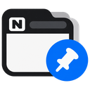

<div align="center">
  

  # Favicon Keeper for Notion

  노션 탭 아이콘이 페이지마다 이모지로 바뀌지 않게 고정하는 Chrome 확장 프로그램.
  탭이 열 개 넘게 열려 있어도 노션 탭을 한눈에 찾을 수 있습니다.
</div>

## 왜 필요한가

노션은 페이지에 설정된 이모지나 이미지 아이콘으로 브라우저 탭의 favicon을 바꿉니다.
페이지 하나만 볼 때는 괜찮지만, 노션 탭 여러 개가 다른 탭들 사이에 섞여 있으면
탭마다 아이콘이 제각각이라 어느 게 노션인지 찾기 어렵습니다.
공유받은 페이지나 공개된 `*.notion.site` 페이지도 마찬가지입니다.

## 설치

웹스토어 등록 전이라 지금은 직접 로드해서 씁니다.

1. 이 저장소를 clone
2. `chrome://extensions` 열기
3. 오른쪽 위 **개발자 모드** 켜기
4. **압축해제된 확장 프로그램을 로드합니다** → 이 폴더 선택

## 기능

- **모든 노션 페이지에서 동작**: 내 워크스페이스, 공유받은 페이지, 공개 페이지(`*.notion.site`)
- **도메인 전부 지원**: `notion.so`, `notion.com`, `notion.site` 및 하위 도메인(`app.notion.com` 등)
- **깜빡임 없음**: 페이지를 옮겨 다닐 때 노션이 아이콘을 바꾸려 해도 처음부터 막아서, 이모지가 잠깐 보이는 일도 없습니다
- **권한 없음**: 노션 도메인에서 실행되는 것 외에 아무 권한도 요청하지 않습니다

## 동작 방식

`content.js` 하나가 노션 페이지에서 `document_start` 시점에, 페이지와 같은 JS 환경
(`"world": "MAIN"`)에서 실행됩니다.

1. `<link rel="icon">`의 `href`를 노션 기본 favicon(`https://www.notion.so/images/favicon.ico`)으로
   바꿉니다. 아이콘 파일을 확장 프로그램에 넣지 않고 노션이 제공하는 주소를 가리키기 때문에
   `web_accessible_resources`가 필요 없습니다.
2. 노션은 페이지를 이동할 때 icon `<link>`의 `href`를 그 자리에서 바꿉니다. Chrome은 href가 바뀌는
   즉시 새 아이콘을 불러오기 때문에, 바뀐 뒤에 되돌리면 이모지가 잠깐 보였다가 돌아옵니다.
   그래서 `<link>`의 `href` setter와 `setAttribute`를 감싸서, 노션이 넣으려는 값을 처음부터
   기본 favicon 주소로 바꿔 넣습니다.
3. 그 밖의 경로로 바뀌는 경우에 대비해 `MutationObserver`로 icon `<link>`와 `<head>`를 감시하다가
   되돌립니다. icon 링크가 모두 지워지면 하나를 새로 넣습니다.

## 개인정보

아무것도 수집하지 않고, 노션 외의 서버로는 어떤 요청도 보내지 않습니다(favicon도 노션 서버에서 불러옵니다). 페이지 내용은 읽지 않으며 탭의 favicon `<link>` 태그만 건드립니다.

## 개발

코드를 고친 뒤 `chrome://extensions`에서 새로고침(↻)하면 바로 반영됩니다.

웹스토어 업로드용 zip은 아래 명령으로 만듭니다. 확장 프로그램에 필요한 파일
(`manifest.json`, `content.js`, `icons/`)만 담습니다.

```bash
./scripts/package.sh   # → favicon-keeper-for-notion-<version>.zip
```

**구조**

- `manifest.json`: Manifest V3, 노션 도메인에만 content script 등록 (Chrome 111 이상)
- `content.js`: favicon 고정 로직 전부
- `icons/`: 확장 프로그램 아이콘 (16 · 48 · 128px)과 원본 이미지 `icon.png` (패키지에는 빠짐)

## 로드맵

- [ ] 팝업에서 사이트별로 켜고 끄기 (`storage` 권한 필요)
- [ ] Chrome 웹스토어 등록
